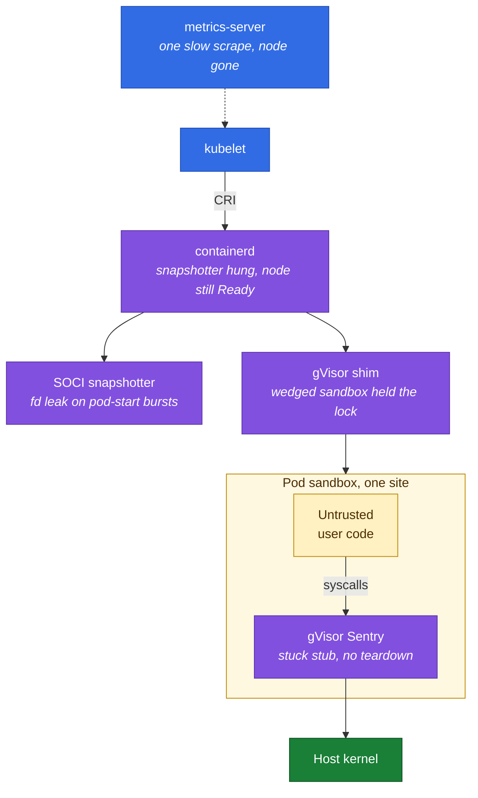

### Hi, I'm Nahum

[Wix](https://www.wix.com) runs about 2.5% of the websites out there. When a site owner writes their own backend code, it runs on the Kubernetes platform I keep running, one site per gVisor sandbox. Dublin.

Untrusted code finds every crack. When a pod hangs and the cause isn't ours, I follow it down the stack until I find whose bug it is. Usually it's open source, so I fix it there and [write up how I found it](https://www.catchkill9.dev).

This is the stack, and where it broke on me:

Nodes said Ready while no new pod could start. A snapshotter had hung and containerd's snapshot GC waited on it forever. My fix [bounded the GC](https://github.com/containerd/containerd/pull/13799), got merged, then got reverted because maintainers wanted it fixed on the client side. Fair. The [deadline on proxy snapshotter calls](https://github.com/containerd/containerd/pull/14187) went in instead.

Pod-start bursts leaked file descriptors in the SOCI snapshotter until it hit its limit. One reader in file Verify never got closed. [Now it does](https://github.com/awslabs/soci-snapshotter/pull/2043).

gVisor is where most of my time goes. A wedged sandbox could hold the shim lock forever, so runsc Kill, Stats and Status [got 30s deadlines](https://github.com/google/gvisor/pull/14549). A missed systrap interrupt could block teardown, so now [only the stuck subprocess dies](https://github.com/google/gvisor/pull/14201), not the sandbox. [The last indefinite waits](https://github.com/google/gvisor/pull/15194) are still in review.

One slow kubelet scrape makes metrics-server drop the whole node from `kubectl top`. [Open](https://github.com/kubernetes-sigs/metrics-server/pull/1908).

It started smaller: [AppArmorProfile owners in the Security Profiles Operator](https://github.com/kubernetes-sigs/security-profiles-operator/pull/1994), 2023.

### prismantis

My Claude Code mod. It draws replies in color right in the terminal: tables, code with copy buttons, mermaid diagrams and charts, 15 themes. Public since October 2, 2026.

   

It started because I'd built a whole VS Code wrapper just to see mermaid diagrams in Claude Code replies. A mod turned out to be the better way.

### Latest posts

- [Pod stuck in Terminating: what it is actually waiting for](https://www.catchkill9.dev/posts/pod-stuck-in-terminating.html)
- [Mermaid charts in Claude Code's terminal: what a mod could do that my VS Code harness couldn't](https://www.catchkill9.dev/posts/prismantis.html)
- [A zero timeout in Go is not no timeout](https://www.catchkill9.dev/posts/go-zero-timeout-is-expired.html)

[Blog](https://www.catchkill9.dev) · [LinkedIn](https://www.linkedin.com/in/lnahum/) · [dev.to](https://dev.to/nahumlitvin) · [RSS](https://www.catchkill9.dev/rss.xml)
